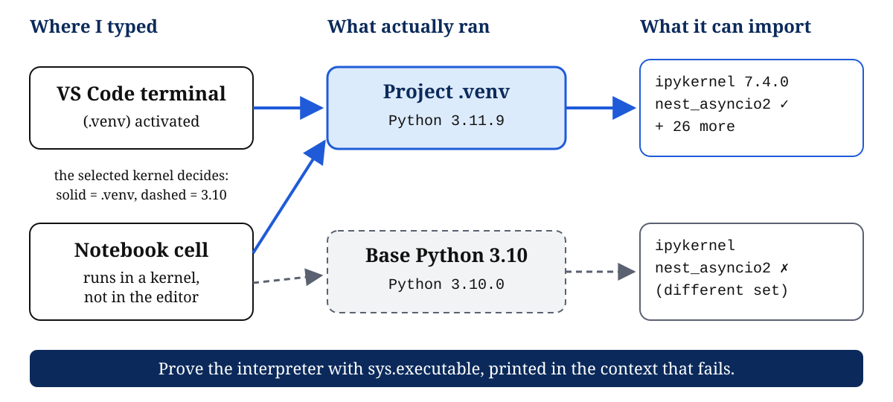
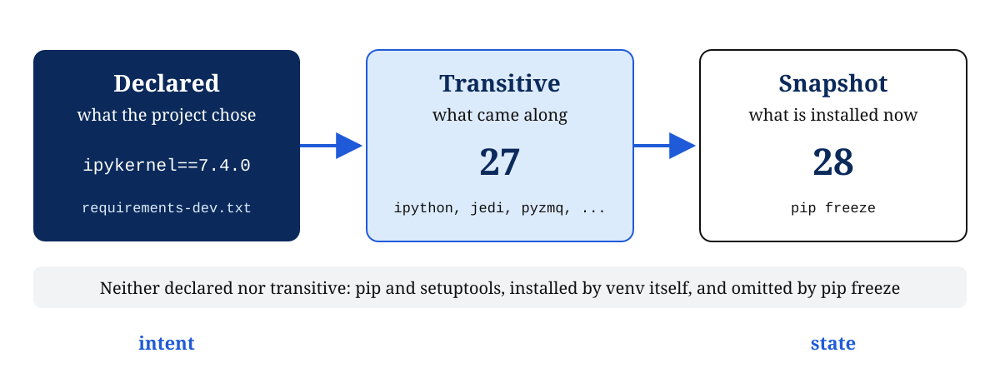
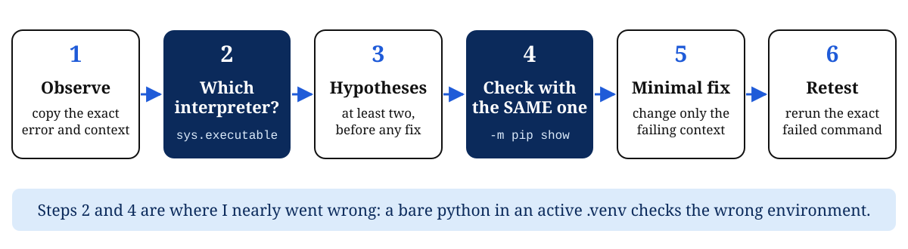

<!--
DRAFT teach-back deck. It was drafted by an AI assistant (Claude) from Daniel's own P0-U02 lab evidence, at Daniel's request.
Daniel reviewed the slides and accepted the wording on 2026-10-16. The last slide's speaker notes are left for Daniel's own takeaway.
Diagrams: slides/phase-0/assets/P0-U02/. Lab evidence: research-notes/phase-0/P0-U02/.
-->

<!-- _class: title -->
<!-- _header: '' -->
<!-- _paginate: false -->

# Which Python ran my code?

## Research Computing Environment: P0-U02 teach-back

Daniel Oyewale · ORMEDIAN Reliable AI Research Training · Phase 0

<!--
Speaker notes: The whole unit comes down to one question. Whenever code runs, which interpreter ran it, and which packages could it see?
-->

---

# The environment is part of the experiment

|                     | Run A  | Run B  |
| ------------------- | ------ | ------ |
| Code commit         | same   | same   |
| Seed                | 42     | 42     |
| Python and packages | **?**  | **?**  |
| AUROC               | 0.82   | 0.80   |

Until the **?** row is filled in, the gap is not evidence about the model.

> Hypothetical example, not a real result.

<!--
Speaker notes: Before I explain a metric difference scientifically, I have to rule out the environment: the Python version, package and preprocessing library versions, and which kernel ran. An unrecorded environment is an uncontrolled variable.
-->

---

# One question explains most environment bugs

<!--
Speaker notes: VS Code is the editor and the notebook is the frontend. Neither one runs Python. An interpreter runs it, and an import works only if that interpreter's site-packages contains the package. The same notebook can fail or succeed depending on the selected kernel.
-->

---

# Observation: three commands, three different claims

| Command | What it showed on my machine | What it actually proves |
| --- | --- | --- |
| `py -0p` | 3.10 (default), Anaconda 3.9, no 3.11 | which Pythons the launcher knows |
| `where.exe python` | Python310 first, WindowsApps alias second | the PATH search order |
| `sys.executable` | `...\Python310\python.exe` | **what actually ran** |

Only the last one is evidence about execution. The others are candidates.

<!--
Speaker notes: This was my baseline before I changed anything. I first thought py -0p listed every Python on the machine and that where.exe showed the one running. Neither is true. Only sys.executable, printed from inside the process, proves which interpreter ran.
-->

---

# A virtual environment: its own interpreter, its own packages

| Activation | Direct path |
| --- | --- |
| `.venv\Scripts\Activate.ps1` | `.venv\Scripts\python.exe ...` |
| puts `.venv\Scripts` first on PATH, in this shell only | skips the PATH search entirely |
| bare `python` now means `.venv` | always `.venv`, no activation needed |

**My evidence:** `sys.prefix != sys.base_prefix` printed `True`, and pip reported `pip 24.0 from ...\.venv\Lib\site-packages`

<!--
Speaker notes: I created .venv with py -3.11 -m venv .venv and left PATH alone, so my existing Python 3.10 work is unaffected. Activation changes only the current shell. A full path works without activation because the interpreter finds its environment from the pyvenv.cfg file next to it.
-->

---

# Declared intent vs installed state

<!--
Speaker notes: I needed a notebook kernel, so I installed one package, ipykernel 7.4.0, and 27 others came with it. I pinned only ipykernel in requirements-dev.txt, which records intent. pip freeze records all 28, which is the state. Rebuilding from the requirements files gave a freeze identical to my environment, on the same machine.
-->

---

# Experiment: the notebook is not the kernel

| Step | What I did or saw |
| --- | --- |
| **Question** | Can a notebook import fail only because of the kernel's interpreter? |
| **Setup** | `nest_asyncio2` exists only in `.venv`; switch the kernel to Python 3.10 |
| **Measurement** | print `sys.executable` *before* the import |
| **Result** | Terminal: `.venv`, import ok. Notebook: `Python310`, `ModuleNotFoundError` |
| **Interpretation** | A kernel mismatch, not a missing install. Selecting the `.venv` kernel fixed it. |

<!--
Speaker notes: I reproduced it safely, without uninstalling anything. I printed sys.executable before the import so the failing cell would still leave evidence. A competing explanation was a stale kernel needing a restart. I ruled it out because a 3.10 kernel can never see a .venv-only package.
-->

---

# Evidence before fixes

**E1 in practice:** colorama was installed in env-a, but the import failed in env-b. `pip show` run through *each* interpreter proved which one owned it. The fix installed it into env-b only.

<!--
Speaker notes: My first check used bare python -m pip show. In my active .venv that would have checked the wrong environment, which is the very mistake I was diagnosing. A second lesson came from a new terminal, which lost my $e1 variable. Hidden shell state is not reproducible.
-->

---

# What I'll do differently

1. Print `sys.executable` **in the failing context** before changing anything.
2. Install with `python -m pip`, so packages land where `python` runs.
3. Record the commit, Python version, interpreter, and a freeze snapshot with every result.
4. Treat environment differences as a hypothesis before treating results as findings.

> Still open: rebuilding on another machine or operating system is untested.

<!--
Speaker notes: My personal takeaway goes here, in my own words. What changed in how I approach a failing import or a surprising result?
-->
